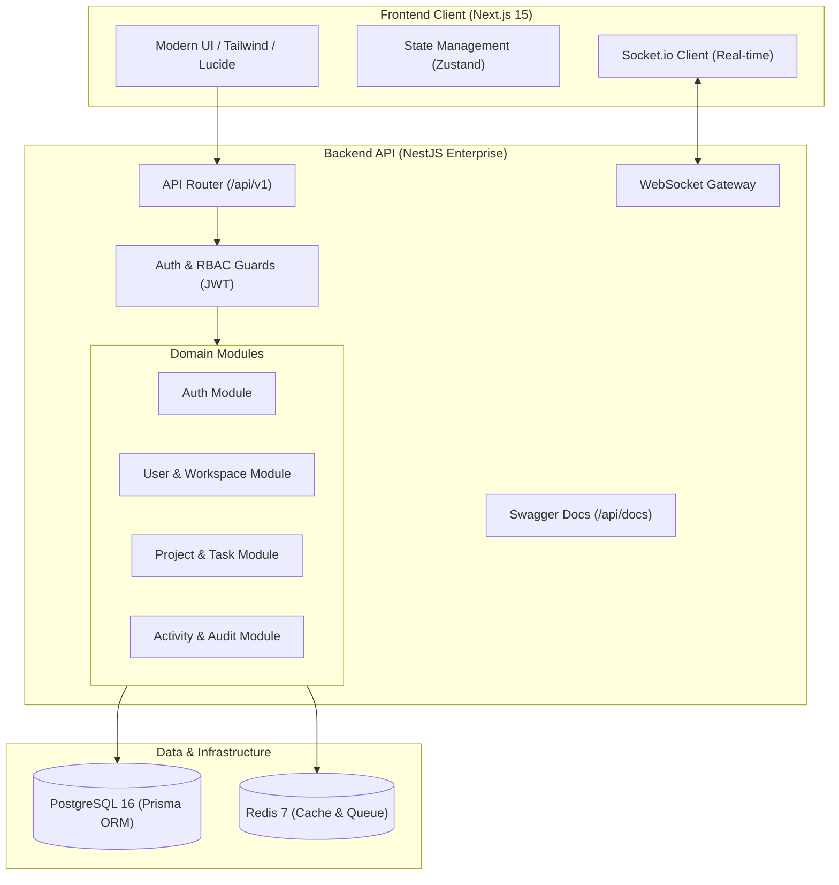

# 🚀 DevSync Enterprise

> **Next-Gen B2B Multi-Tenant Project Management & Engineering OS**  
> *Production-grade full-stack platform built with Next.js 15, NestJS, PostgreSQL, Prisma, WebSockets, Redis, and Docker.*

---

## 📌 Loyiha Haqida (Project Overview)

**DevSync Enterprise** — bu zamonaviy dasturiy ta'minot jamoalari uchun mo'ljallangan yuqori unumdorlikdagi B2B platforma (Linear, Jira va Slackning eng yaxshi tomonlarini o'zida jamlagan gibrid tizim).

Loyiha **7 kunlik professional sprint** davomida har kuni yangi modullar, toza arxitektura va testlangan yechimlar bilan bosqichma-bosqich ishlab chiqilmoqda.

---

## 🛠 Tech Stack

| Qatlam | Texnologiyalar |
| :--- | :--- |
| **Frontend** | Next.js 15 (App Router), React 18/19, TypeScript, Tailwind CSS, Lucide Icons, Zustand, TanStack Query |
| **Backend** | NestJS (Enterprise Modular Architecture), TypeScript, Prisma ORM, Class-Validator, Swagger (OpenAPI) |
| **Database & Cache** | PostgreSQL 16 (Relational DB), Redis 7 (Caching & Pub/Sub) |
| **Real-time** | WebSockets (Socket.io) — Real-time Kanban board updates, instant notifications |
| **DevOps & Infra** | Docker, Docker-Compose, GitHub Actions (CI/CD) |

---

## 🏗 Arxitektura (System Architecture)



---

## 🗓 7-Kunlik Sprint Rejasi (Sprint Roadmap)

- [x] **1-kun (Bugun):** Arxitektura dizayni, Monorepo strukturasi, Docker (PostgreSQL & Redis), Prisma ma'lumotlar bazasi sxemasi, Frontend boshlang'ich UI.
- [x] **2-kun:** Multi-Tenant Autentifikatsiya (JWT, Refresh Token), RBAC rollar (Owner, Admin, Member, Viewer), Login & Register sahifalari, Zustand Auth Store.
- [x] **3-kun:** Asosiy Biznes API (Workspaces, Projects, Tasks CRUD) va Frontend Dashboard (Responsive Sidebar, Navbar, Workspace Switcher, Interaktiv Kanban doskasi).
- [x] **4-kun:** Kengaytirilgan qidiruv (`Ctrl+K`), Server-side pagination, Vazifa tafsilotlari modali, Izohlar (Comments), Fayl yuklash (Uploads) va Keshlash (Cache).
- [x] **5-kun:** Real-Time WebSockets (`Socket.io`), Interaktiv Drag & Drop Kanban board, Jonli bildirishnomalar (Notifications) va Jamoaga a'zo taklif qilish.
- [ ] **6-kun:** Katta Admin Analitika paneli, Audit loglar, Hisobotlarni PDF/Excel ko'rinishida eksport qilish.
- [ ] **7-kun:** Docker Compose orkestratsiyasi, CI/CD pipeline, Testlar va yakuniy Production deployment.

---

## 🗄 Ma'lumotlar Bazasi Sxemasi (Data Entities)

Loyiha quyidagi asosiy mantiqiy jadvallarga ega:
1. `User` — Foydalanuvchilar va tizim rollari.
2. `Workspace` — Alohida kompaniyalar yoki jamoalar maydoni (Multi-Tenancy).
3. `WorkspaceMember` — Har bir ish maydonidagi a'zolar va ularning darajalari (RBAC).
4. `Project` — Ish maydoni ichidagi loyihalar (Project Key, masalan `DEV`, `OPS`).
5. `Task` — Vazifalar, ustunlar (Backlog, Todo, In Progress, In Review, Done) va Drag & Drop tartibi (`orderIndex`).
6. `Comment` — Vazifalar bo'yicha jamoaviy muhokamalar.
7. `ActivityLog` — Har bir harakatning to'liq audit jurnali.

---

## 🚀 Loyihani Ishga Tushirish (Quickstart)

### 1. Infratuzilmani ishga tushirish (Docker)
```bash
docker-compose up -d
```

### 2. Backendni ishga tushirish
```bash
cd backend
npm install
npx prisma generate
npm run start:dev
```
*API hujjatlari:* `http://localhost:4000/api/docs`

### 3. Frontendni ishga tushirish
```bash
cd frontend
npm install
npm run dev
```
*Frontend interfeysi:* `http://localhost:3000`

---

## 📄 Litsenziya
MIT License — Ushbu loyiha o'rganish, ishlab chiqish va portfolioshunoslik uchun ochiq.
